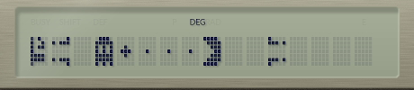

[ [Engligh](README.md) | [日本語](README_ja.md) ]

---

# PC1245-Catch The Pac!



<!--※某誌風ドキュメントは[こちら](./doc/pc1245-earthdefender.pdf)-->

<br>

## 概要

1983年に日本のシャープから発売された、ポケットコンピュータ"PC-1245"のプログラムです。<br>
BASICとマシン語で構成されています。<br>

<br>

## 遊び方

- モンスターを操作して、パックマンを捕まえるのが目的のゲームです。
- 画面にはドットとパワーエサがあります。パックマンはドットがあるところでは遅く、ないところでは早く動きます。モンスターは逆に、ドットがあるところは早く、ないところでは遅く動きます。
- 画面の左右はワープトンネルで、反対側にワープします。
- モンスターがパックマンを捕まえると、パックマンがやられて次のパックマンが登場します。
- パックマンがパワーエサを食べると、一定時間モンスターがイジけます。このときにパックマンに捕まると、ゲームオーバーです。パワーエサを食べたパックマンは、常に早く移動します。

<br>

## 操作方法

- [4][6] : モンスター移動
 
<br>

## 実機でロードする

カセットインターフェースをポケットコンピュータに接続してから、PCのヘッドフォン端子と接続します。<br>
ポケットコンピュータで以下コマンドでマシン語プログラムのロード状態にしてください。<br>

```
CLOADM &C500
```

PCで次のWAVファイルを再生することでロードできます。<br>

```
/wav/CatchThePac-bin-C500.wav
```

続いて、ポケットコンピュータで以下コマンドでBASICプログラムのロード状態にしてください。<br>

```
CLOAD
```

PCで次のWAVファイルを再生することでロードできます。<br>

```
/wav/CatchThePac-bas.wav
```

<br>

## PokecomGoでプレイする

スマートフォンに以下に2ファイルを転送し、アプリでロードしてください。

```
/src/CatchThePac.bas
/dist/CatchThePac.bin
```

> .binファイル名を`CatchThePac-C500.bin`としておくと、ロード時に自動で開始アドレスが設定されます。

<br>


<br>

## PC-1251 Emulatorでプレイする

以下のファイルを、`~/.pc1251/programs`ディレクトリにコピーします。

```
/src/CatchThePac.bas
/dist/CatchThePac.bin
```

`/src/CatchThePac.bas`の先頭に以下の行を追加します。

```
# bin: CatchThePac.bin &C500
```

PC-1251 Emulatorを起動し、[Ctrl]+[O]で選択すると実行されます。

<br>

## 作者

Hitoshi Iwai (aburi6800)

<br>

## 更新履歴

2026/10/21 ver0.50
- ベータ版リリース

<br>

## ライセンス

MIT Licence

<br>

## 謝辞

- [SC61860 Asembler YASM61860](https://www.oit.ac.jp/labs/rd/rssrv/kobayashi-lab/~yagshi/old_web/misc/pocketcom/yasm.html)
- [Pocket Tools](http://pocket.free.fr/html/soft/pocket-tools_e.html)
- [Genymotion](https://www.genymotion.com/)
- [Pokecom Go](https://digihori.jimdofree.com/index/emulator/)
- [PC-1251 Emulator](https://github.com/woriguchi/pc1251-emulator/tree/main)
